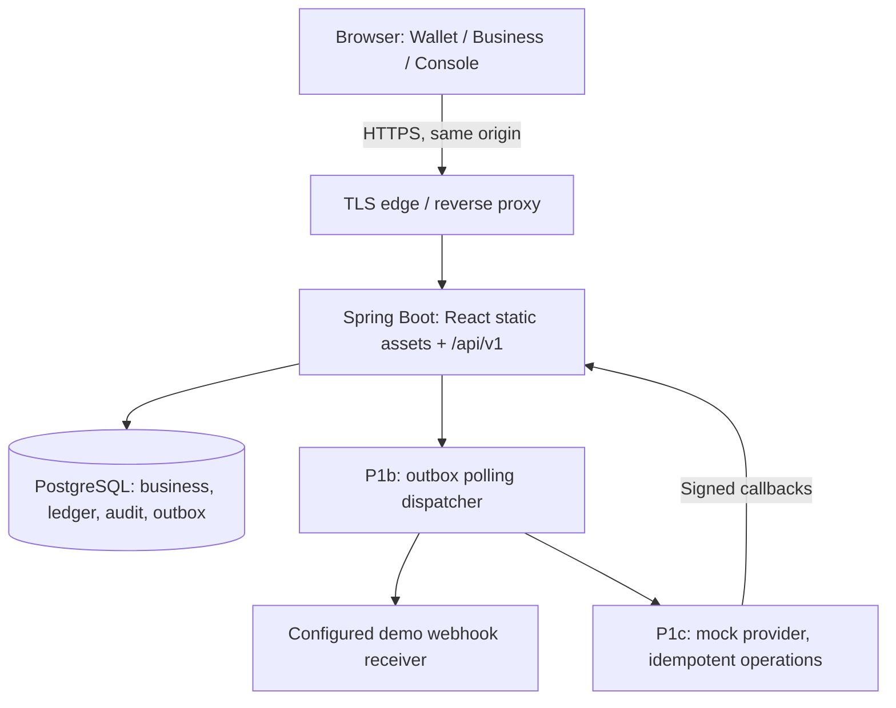
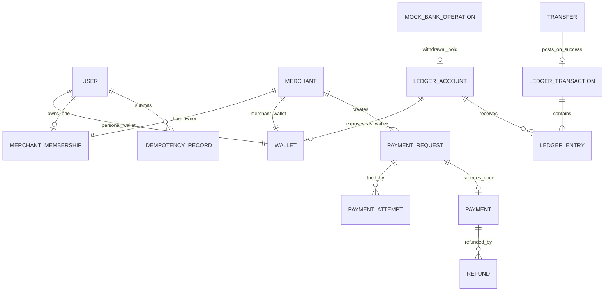
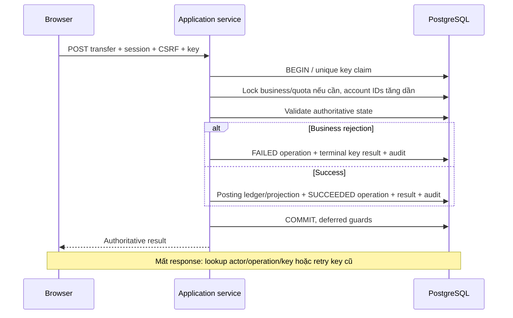

# NexaPay — System Architecture v0.2

**Status:** ACCEPTED design baseline — theo ủy quyền của chủ dự án ngày 01/11/2026  
**Date:** 2026-11-01  
**Based on:** [Context](NexaPay_Context.md), [PRD](NexaPay_PRD_v0.1.md), [ADR-001](adr/ADR-001-project-baseline.md)  
**Detailed money behavior:** [Money Movement & Recovery](NexaPay_MONEY_MOVEMENT_SPEC_v0.2.md)

> Logical/solution architecture đã chốt để triển khai P0. Tên file giữ v0.1 để bảo toàn link; nội dung là v0.2. Đây không phải DDL/OpenAPI hoàn chỉnh hoặc bằng chứng code/test đã đạt. DDL, OpenAPI và fixtures được viết theo slice; không cần phê duyệt lại baseline Accepted.

## 1. Quality drivers và constraints

| ID | Driver | Quyết định |
|---|---|---|
| AR-01 | Financial correctness | Một PostgreSQL transaction cho business result + ledger + projection + idempotency + audit |
| AR-02 | Retry/recovery | Database-backed actor/operation/key/fingerprint; lookup không cần transaction ID; terminal replay giữ nguyên |
| AR-03 | Concurrency | READ COMMITTED, row locks nhất quán, DB guards; không overspend |
| AR-04 | Isolation/security | Session identity, RBAC + resource ownership; merchant membership, không tin role/source từ client |
| AR-05 | Maintainability | Modular Monolith; module API tối thiểu; ledger sở hữu mọi money writes |
| AR-06 | UX | SPA ba workspace; authoritative results; xử lý unknown/offline/re-auth |
| AR-07 | Demoability | Local Docker/CI trước, same-origin deploy; dữ liệu giả, quota/rate limits |
| AR-08 | Reliability | Reconciliation P0; DB outbox P1b; mock-bank hold/inbox P1c |

Không event-source toàn hệ thống, không microservices/broker/Redis trong baseline. ArchUnit kiểm tra dependencies; Spring Modulith không bắt buộc.

## 2. Context và deployment



- Một backend instance. Build frontend trước và bundle dist vào backend static resources trong Docker image; SPA fallback chỉ cho frontend routes, không che API 404 hoặc Actuator.
- Local: Vite proxy /api vào backend để giữ browser same-origin; Compose cho DB/backend/frontend hoặc dev frontend riêng với cùng proxy rule. Không CORS wildcard có credentials.
- Public: cùng host cho SPA/API, TLS termination, database private, secret env/config, health/readiness công khai tối thiểu; Actuator nhạy cảm không expose public.
- Rate limiter và HTTP sessions in-memory; restart cần login lại. Money records/quota/keys không mất. Scale-out yêu cầu ADR cho session/rate limiting, không tự bật multi-instance.
- Testcontainers PostgreSQL cho DB integration; không dùng H2 để kết luận về locks/constraints.
- P1 dispatcher trong cùng Spring process; crash/restart phục hồi từ DB. Không gọi provider/receiver trong DB money transaction.

## 3. Technology baseline

| Layer | Stack |
|---|---|
| Web | React + TypeScript + Vite, Fluent UI React v9 và Fluent System Icons |
| Data/forms | TanStack Query, React Hook Form, Zod; không optimistic money success |
| Backend | Java 21 LTS, Spring Boot stable tương thích; pin exact versions tại scaffold |
| REST | Spring Web, Bean Validation, OpenAPI; /api/v1 |
| Security | Spring Security HTTP session + CSRF, BCrypt PasswordEncoder |
| Data | PostgreSQL, JPA, Flyway; native SQL/locking queries khi JPA không diễn tả rõ |
| Async | P1b DB outbox + polling; P1c inbox/mock provider; không broker |
| Verification | JUnit, Mockito, Testcontainers, ArchUnit, Vitest/Testing Library, Playwright/axe |
| Delivery | Docker Compose, GitHub Actions; Actuator/Micrometer cơ bản, structured logs |

Không khóa patch version trong design doc vì cần kiểm tra support/compatibility lúc scaffold. Dependency versions thật phải reproducible trong build/lockfile.

## 4. Module ownership

| Module | Release | Owns / capability | Không được làm |
|---|---|---|---|
| identity/profile | P0 | User, credential/session, roles, display name và exact recipient identity | Money writes; public ADMIN grant |
| wallet | P0 | Wallet ownership/metadata; queries, account status action qua ledger API | Lưu balance bản sao; set balance |
| ledger | P0 | LedgerAccount, transaction/entries, MoneyPostingService, account locking/status | HTTP setBalance; sửa posted history |
| transfer | P0 | Orchestrate P2P; operation/result/status lookup | Tự ghi ledger/projection ngoài posting API |
| demofunding | P0 | Issuance funding, DB quota; gọi posting | Seed/update balance tùy ý |
| command | P0 | Idempotency claim/fingerprint/result và actor-scoped lookup/recent commands | Tách commit key khỏi P0 money transaction |
| audit | P0 | Durable actor/action/resource/outcome/correlation facts | Thay thế financial ledger |
| reconciliation | P0 | Read-only snapshot checks, CLI report/exit status | Auto-repair balance |
| merchant | P1a | Merchant + OWNER membership, one merchant/user | Tự cấp ADMIN hoặc bypass ownership |
| payment | P1a | Request/attempt/payment; one capture, cancel/expire | Pay qua asynchronous credit |
| refund | P1a | Synchronous refund, limit + original payer linkage | Pending debt/over-refund |
| notification | P1b | Outbox dispatch, in-app delivery, webhook attempts | Đổi money outcome khi delivery lỗi |
| administration | P1b | Queries, lock/unlock với reason, audit investigation | Sửa ledger, force provider success |
| reporting | P1b | Actor-scoped CSV và metrics aggregates | Export dữ liệu không có quyền |
| mockbank | P1c | Operation/provider boundary/inbox, hold/settle/release | HTTP trong money tx; release vì timeout |

Controllers chỉ gọi module application API. Public module capabilities là typed commands/results, không expose repositories/JPA entities xuyên module. Các orchestrator dùng ledger/command/audit capabilities trong cùng transaction. Wallet đọc ledger projection qua query API; ledger không phụ thuộc wallet, tránh cycle. Thêm module/layers khi slice cần, không tạo mọi lớp rỗng.

## 5. Conceptual data model



Các quan hệ Wallet với USER/MERCHANT là **exclusive ownership**, không bắt mỗi Wallet đồng thời có cả hai owner. DDL dùng user_id hoặc merchant_id (exactly one non-null), unique theo owner/currency và unique ledger_account_id. System accounts không có Wallet. Merchant membership unique merchant và unique owner_user cho baseline một-owner/một-merchant.

- LedgerAccount.postedBalance là projection mutable duy nhất, transactionally consistent với immutable ledger. Wallet API lấy balance từ account, không có persistent Wallet.balance thứ hai.
- VND nguyên, long/BIGINT; money JSON string; fee=0, command max 100 triệu VND, customer total max 1 nghìn tỷ. Giới hạn/defaults chính thức ở ADR-001.
- Các account PERSONAL/MERCHANT nonnegative; DEMO_ISSUANCE/MOCK_CLEARING signed và kiểm tra overflow. WITHDRAWAL_HOLD riêng mỗi operation.
- Ledger transaction unique (operationType, operationId), nonzero same-currency entries, ít nhất 2 entries và tổng 0; FK cho account/business references khi có thể.
- Posted ledger không UPDATE/DELETE, không append entry vào transaction cũ đã commit. App runtime role tách migration owner; trigger buộc header/entries được tạo trong cùng DB transaction.
- Deferred commit guards kiểm tra transaction header không rỗng và entries cân bằng/currency đúng; không dùng CHECK cross-row. CHECK/NOT NULL/UNIQUE/FK bảo vệ từng dòng và identities.
- Tất cả tài khoản bootstrap 0; funding seed đi qua use-case/quota/ledger. Không initialization balance khác 0 ngoài posting.
- Audit và financial ledger riêng; idempotency technical result không là financial journal.
- History sort (createdAt DESC, id DESC), cursor pagination, filters server-side và bounded page size (default 20/max 100); timestamps UTC ISO 8601. Giá trị money trong thống kê cũng là string.

DDL chi tiết phải có migrations và tests của guards/permissions. Không tuyên bố mô hình signed demo là hệ thống kế toán tuân thủ đầy đủ.

## 6. P0 transaction và recovery



- READ COMMITTED được chọn; status/funds/limits được đọc lại dưới row lock. Account status là nguồn trạng thái ACTIVE/LOCKED của Wallet.
- Lock order: key → business aggregate → quota rows → accounts tăng dần → append records. PaymentRequest trước Payment nếu có; admin lock chỉ account + audit.
- Business FAILED được commit như result bình thường, không throw rollback exception. Failed transfer chỉ initiator/operator thấy; recipient chỉ thấy incoming thành công.
- SQL/technical error rollback toàn bộ key/operation/ledger/projection/audit. Tối đa 2 retries sau attempt đầu trong tổng server command budget 20s; lock wait 2s, statement 5s. Không retry khi hết budget hoặc tiếp tục một aborted transaction.
- P0 không commit IN_PROGRESS rồi xử lý async; không HTTP 202 cho synchronous transfer/funding.
- Replay cùng key/hash trả original terminal resource/status/result; đổi payload 409. Terminal business error không được tự chạy lại vì balance đã thay đổi.
- Lookup 404 COMMAND_NOT_OBSERVED chỉ là chưa thấy committed result. Không đồng nghĩa failed vì transaction có thể còn chạy. Giữ key/payload, không tự tạo intent mới.
- Retain terminal keys cả vòng đời dataset, không TTL riêng. DB reset đổi environmentEpoch và reset dataset nhất quán. Session restart không reset keys/quota.
- [Money Movement Spec](NexaPay_MONEY_MOVEMENT_SPEC_v0.2.md) là nguồn protocol chi tiết, failure matrix và budgets.

## 7. Merchant/payment/refund (P1a)

- One OWNER membership; self-onboard merchant mô phỏng ACTIVE, wallet mới 0. Không staff/KYC approval hoặc merchant withdrawal.
- PaymentRequest PENDING → PAID/EXPIRED/CANCELLED; fixed merchant/amount/currency/expiry (default 30m, 5m–24h).
- Nhiều PaymentAttempt thất bại có thể tồn tại; chỉ một Payment thành công (unique request ID). Không có PaymentRequest FAILED vì một payer thiếu tiền.
- Pay/expire/cancel serialize bằng request lock; lấy actual DB clock sau lock kiểm tra expiry. PAID không bị job expire override; pay accepted trước expiry được commit hoàn tất.
- Không tự pay merchant mình sở hữu; merchant balance không dùng như P2P wallet.
- Full/partial refund đồng bộ; lock payment rồi accounts, merchant ACTIVE/đủ tiền; successful refund sum không vượt payment. Payer locked được nhận refund.
- Payment gốc vẫn PAID; refundedAmount và refundStatus NONE/PARTIAL/FULL riêng. Ledger refund liên kết original payment/refund.

## 8. Outbox, notifications và export (P1b)

- Business money transaction ghi outbox fact cùng commit; publisher không là điều kiện để kết luận money success.
- Dispatcher claim bằng DB lease ngắn (30s, renew khi cần); không giữ row lock trong HTTP. Crash sau send trước ack gây duplicate, receiver dedup stable event ID.
- Event có id, type, aggregate ID/version, occurredAt, schemaVersion và payload tối thiểu; không PII/secret snapshot.
- Webhook chỉ tới receiver allowlist cấu hình môi trường; merchant UI không nhập arbitrary URL. Disable redirects; HTTPS khi public; timeout 5s. Chặn SSRF bằng destination config/network policy, không chỉ HMAC.
- HMAC-SHA256 trên timestamp + raw payload; timestamp tolerance 5m, ký timestamp mới mỗi delivery attempt; event ID ổn định; receiver constant-time verify/dedup. Callback provider là incoming contract riêng.
- 8 attempts theo ADR-001; max attempts → FAILED delivery giữ payload/attempt history. Operator retry cùng event ID, có audit, không tạo payment/event tiền mới.
- Event delivery ordering không được giả định; receiver dùng aggregate version/status lookup khi cần. Baseline receiver là ứng dụng demo do dự án quản lý.
- In-app notification unique (recipient,eventId); consumer idempotent; failure không rollback tiền.
- CSV export owned history: cùng filters/timezone được ghi rõ, tối đa 10000 rows/export, báo khi vượt limit thay vì truncate im lặng; quote/escape fields và neutralize spreadsheet formulas trong user-supplied text. PDF ngoài baseline.

## 9. Mock banking (P1c)

- Provider boundary ngoài money tx; dispatch từ outbox, stable operation ID/idempotency tại provider. Callback inbox unique provider/event ID, ký, xác nhận operation/amount/currency trước transition.
- Deposit PENDING không post tiền; success post clearing→customer. Customer locked sau acceptance vẫn nhận completion. Vượt total balance limit → NEEDS_REVIEW, không post thiếu/nhân đôi.
- Withdrawal acceptance post customer→hold(op); available giảm ngay, held phản ánh tiền chờ. Success hold→clearing; definitive failure hold→customer. Completion không bị wallet lock sau accept chặn.
- Max customer balance kiểm tra available+held để reserve chỗ hoàn hold; incoming commands cũng kiểm tra total này dưới lock customer account. Hold create/settle/release đều lock personal account liên quan cùng các account còn lại theo ID, kể cả settle không có entry vào personal.
- Pending timeout 15m → NEEDS_REVIEW, vẫn giữ hold; provider status query/reconcile cùng operation ID. Operator không force result tùy ý.
- P1c HTTP 202 là durable acceptance; idempotency replay acceptance gốc, GET operation trả state mới. State và ledger/inbox transition atomic.
- Duplicate/out-of-order không lùi terminal state; terminal mâu thuẫn audit/review, không tự bù. Hold chỉ settle hoặc release đúng một lần; terminal hold balance=0.

## 10. Authentication/authorization/security

- Browser same-origin với API, session cookie HttpOnly/Secure/SameSite=Lax; localhost HTTP chỉ được bỏ Secure trong local profile. Không cookie/domain rộng không cần thiết, không JWT localStorage.
- CSRF bật cho unsafe browser methods gồm login/signup/logout; GET CSRF bootstrap và refresh sau login/logout. API authentication error trả JSON 401, frontend điều hướng; không HTML login redirect loop.
- Session fixation protection đổi session ID khi login; idle 30m/absolute 8h, không remember-me; logout POST + CSRF invalidate session và clear cookie. Restart instance yêu cầu login lại.
- PasswordEncoder BCrypt cost 12, prefix hỗ trợ nâng cấp; password 12–64 ký tự và tối đa 72 UTF-8 bytes, reject vượt byte limit, không truncate, cho phép paste/password manager. Không complexity rule tùy tiện; đo hash cost khi scaffold.
- Email normalize trim/lowercase cho identity demo; unique DB. Display name là plain text có max length; escape output; recipient lookup exact wallet public ID, không email/user directory.
- P0 chưa có email verification, password reset/change password/email; UI không hiện các controls chưa triển khai. Dùng dữ liệu giả; đây là giới hạn portfolio.
- Server kiểm tra ownership cho wallet/transfer/command/export và membership cho merchant resources. Unrelated resource trả 404; thiếu quyền workspace trả 403. Role nav không thay backend authorization.
- Rate limit defaults ở ADR-001, 429 có Retry-After. Login generic failure, secrets không log; exact wallet lookup giới hạn tốc độ. Faucet quota luôn DB-backed, không dựa rate limiter in-memory.
- Lock/unlock cần permission + reason + audit cùng transaction. Admin không có API sửa ledger/balance, không auto-grant từ request.
- CSP phù hợp SPA, security headers, bounded request sizes và field validation; secret env không bundle frontend. Audit login failure không chứa password/token/raw idempotency keys.

## 11. API/frontend boundaries

- Prefix /api/v1; typed resource/status/UTC timestamps, JSON money strings, structured errors {code,message,correlationId,fieldErrors?}.
- 400 schema/format, 401 unauthenticated, 403 permission/CSRF, 404 unrelated/not observed, 409 idempotency conflict, 422 committed business failure, 429 throttle, 503 retryable/unresolved technical.
- POST transfers/fundings: 201 SUCCEEDED hoặc 422 committed FAILED; lookup /commands/{operationType}/{key} trả 200 terminal result hoặc 404 not observed. GET /commands có actor-scoped cursor list để recover recent committed commands; không list user khác.
- Command result gồm originalHttpStatus/resourceId/status/result hoặc error; không trả current balance cũ như số dư authoritative hiện tại.
- Checkout /pay/:paymentId dùng opaque unguessable public reference, chỉ merchant display/amount/description/expiry/status; không payer PII. Login returnTo chỉ local allowlisted paths.
- Query keys gồm actorId + workspace/merchantId; logout/account switch cancel requests và clear cache trước render account mới. Stale inflight response không được ghi vào cache account mới.
- Recovery reference ở sessionStorage, draft còn trong memory; reload chỉ GET lookup, không auto POST. Recent committed commands phục vụ tab mới; không hứa recover một uncommitted intent đã mất reference.
- Sau mutation refetch balance/history/request. UNKNOWN là client knowledge state; không optimistic success/credit, không retry với key mới.
- Frontend organization: app routes/providers, shared UI/theme, feature use-cases, typed API/query keys. P0 /auth và /app; P1a /business và /pay; P1b /console.

## 12. Audit, reconciliation và observability

- Durable audit từ P0: actor, action, resource ID, UTC time, outcome, correlation ID; money success/rejection cùng commit, admin action cùng commit.
- Technical rollback không giữ audit cùng transaction đã rollback; structured technical logs/correlation và metrics phục vụ lỗi đó. Không giả tạo FAILED financial record.
- Reconciliation CLI P0 trên REPEATABLE READ read-only snapshot: projection↔entries, balanced journal/currency/count, operation uniqueness/linkage, limits/quota/issuance. Không tự repair; exit khác 0 và report IDs.
- P1c kiểm hold/settle/release và pending review; P2 mới có dashboard reconciliation.
- P0 health/readiness/structured logs/Micrometer counters; P1b outbox lag/retry/delivery failure; P1c pending age/review count; P2 traces/load dashboards.
- Report benchmark phải ghi hardware/dataset/concurrency/window/p95. Budgets trong spec không phải throughput đã đạt.

## 13. Verification gates

| Gate | Evidence bắt buộc |
|---|---|
| P0 domain/data | Invalid amount/self-transfer, quota, ownership; Flyway clean DB và migration repeatability |
| P0 money | MM-01–08 ở Money Movement Spec; PostgreSQL concurrency/rollback/commit-loss; app-role guards |
| P0 API/security | Session/CSRF/logout, malformed money, business failure replay, unauthenticated/unrelated resources, lookup-not-observed |
| P0 UI/E2E | Signup→funding→transfer→history; unknown/re-auth/reload, query cache isolation; responsive/keyboard/contrast |
| P1a | MM-09; request attempts/one capture, expiry/cancel races, partial/concurrent refund |
| P1b | Crash send-before-ack, lease recovery, HMAC/replay/dedup, allowlisted destination, Console authz, CSV formula handling |
| P1c | MM-10–11; hold/settle/release, locked completion, duplicate/out-of-order/provider contradiction |
| CI | Compile, lint/typecheck, migrations, tests; frontend build và packaged same-origin SPA/API smoke |

Không dùng coverage percentage thay bằng chứng correctness. Failure injection có thể ở test harness; không expose public API gây lỗi/sửa tiền.

## 14. Repository và delivery

```text
frontend/
backend/
infra/
Docs/
  NexaPay_Context.md
  NexaPay_PRD_v0.1.md
  NexaPay_SYSTEM_ARCHITECTURE_v0.1.md
  NexaPay_UIUX_DESIGN_SPEC_v0.1.md
  NexaPay_MONEY_MOVEMENT_SPEC_v0.2.md
  adr/ADR-001-project-baseline.md
.github/workflows/
README.md
```

Giữ đúng chữ hoa Docs để links hoạt động trên Linux. Chưa phải cây code đã tạo. Environments local/test/demo tách credentials/dataset; fictitious seeds qua funding, không default public ADMIN password. Dataset reset thủ công toàn môi trường, đổi epoch; không public reset endpoint. Backup/recovery runbook tối thiểu trước public demo: documented dump/restore hoặc reproducible reset, không claim SLA tiền thật.

Delivery: P0 DDL/OpenAPI/tests từng slice → local vertical slice → CI → optional public demo → P1a → P1b → P1c. Không dựng toàn bộ UI mock hoặc infrastructure P1 trước.

## 15. PRD mapping

| Requirement | Module/UI |
|---|---|
| FR-A01–04 | identity/profile; auth/profile/route guards |
| FR-W01–03 | wallet/ledger; balance/status |
| FR-F01 | demofunding/ledger/command; funding quota/result |
| FR-T01–04, FR-L01 | transfer/ledger/command; review/result/recovery |
| FR-H01 | owned history/details/recent commands |
| FR-AU01, FR-RC01 | audit/reconciliation P0; CLI/tests, chưa Console |
| FR-M01, FR-P01–03, FR-R01 | merchant/payment/refund P1a; Business/Checkout |
| FR-N01, FR-I01 | notification/outbox P1b; delivery status |
| FR-AD01–02 | administration/audit P1b; Console |
| FR-Q01 | reporting P1b; CSV export |
| FR-B01 | mockbank/inbox/ledger P1c; available/held/status |
| FR-Q02–04 | optional P2 dashboard/rules/developer API |

## 16. Implementation guardrails và changelog

- Baseline Accepted cho phép bắt đầu scaffold/DDL/OpenAPI P0. Đọc PRD/ADR/Money/UI trước; gắn task với FR/BR và acceptance.
- Không tạo endpoint setBalance, bypass auth, broker/Redis/Keycloak hoặc async P2P credit; thay quyết định phải có ADR kế tiếp.
- Thông tin chưa có: ngân sách/giờ mỗi tuần/deadline và host cụ thể. Pin dependency versions, wireframes, DDL/OpenAPI là task implementation, không lý do chờ phê duyệt lại baseline.
- Technical sources ở [ADR-001](adr/ADR-001-project-baseline.md); guides hỗ trợ thiết kế, không chứng nhận phần mềm.

**v0.2 — 2026-11-01:** Chốt stack/auth/isolation/ledger ownership/JSON money; system account và commit guards; terminal idempotency/recovery; audit/reconciliation P0; P1a/b/c, DB outbox, withdrawal hold; merchant membership/attempts/CSV mapping, cùng-origin deployment và quality gates. Thay toàn bộ lựa chọn Draft còn treo thuộc phạm vi ADR-001.
