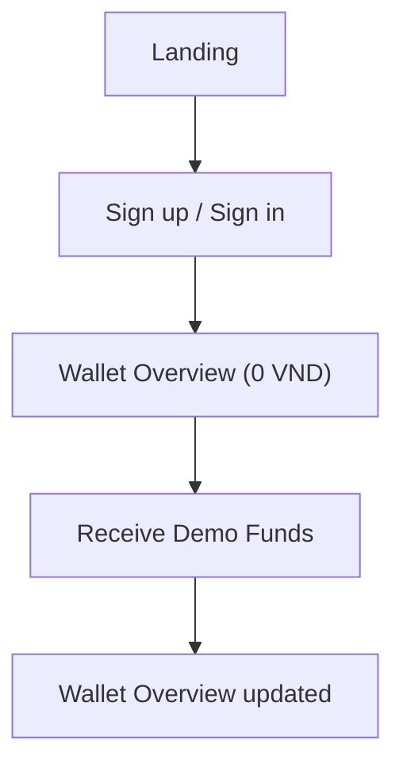
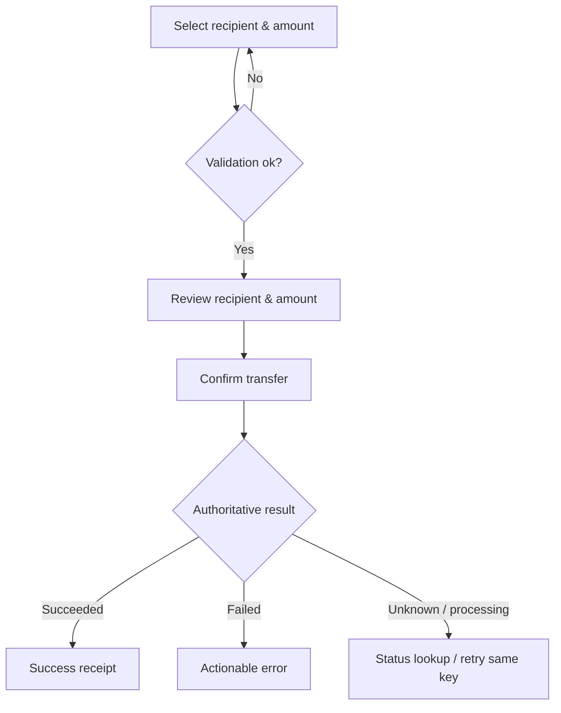

# NexaPay — UI/UX Design Specification v0.2

**Status:** ACCEPTED behavior baseline; visual measurements cần kiểm chứng qua prototype  
**Date:** 2026-11-01  
**Based on:** [Context](NexaPay_Context.md), [PRD](NexaPay_PRD_v0.1.md), [Architecture](NexaPay_SYSTEM_ARCHITECTURE_v0.1.md), [ADR-001](adr/ADR-001-project-baseline.md), [Money Movement](NexaPay_MONEY_MOVEMENT_SPEC_v0.2.md)  
**Product:** Responsive web; Wallet P0, Merchant/Checkout/Refund P1a, Console/notification/CSV P1b, Mock Banking P1c.

> Các quyết định sản phẩm/behavior đã chốt theo ủy quyền chủ dự án. Tokens/số pixel là starting values để kiểm chứng contrast, reflow và prototype, không phải screen đã được thiết kế/test. Giữ tên file v0.1 để bảo toàn link; nội dung là v0.2. Logo cần asset export cuối; không chặn P0 bằng việc chờ bộ nhận diện hoàn chỉnh.

## 1. Design Vision

**NexaPay** phải mang cảm giác như một fintech product thật: rõ ràng, sạch, đáng tin, nhanh hiểu và xử lý lỗi minh bạch. Không sao chép layout/branding của MoMo, PayPal hoặc bất kỳ sản phẩm thương mại nào.

**Design pillars:**

1. **Clarity over decoration:** Số tiền, người nhận, trạng thái và hành động tiếp theo luôn dễ nhìn.
2. **Confidence by confirmation:** Money-changing flows có kiểm tra thông tin và màn hình xác nhận; không nhầm `pending` với `success`.
3. **Consistent experience:** Wallet, Business, Console dùng chung components, tokens, icon language và behavior.
4. **Professional polish:** Loading, empty, error, disabled, hover, focus, success được thiết kế rõ; không để giao diện “CRUD skeleton”.
5. **Responsive by role:** Wallet mobile-first; Business/Console desktop-first nhưng không bỏ qua mobile/tablet.
6. **Accessible & honest:** Keyboard navigation, contrast, ngôn ngữ dễ hiểu, cảnh báo rõ rằng số dư là tiền giả lập.

**Visual direction:** Modern Fintech Minimalism kết hợp nguyên tắc Fluent Design 2; sử dụng Fluent UI React v9 (`@fluentui/react-components`) làm nền các control, NexaPay theme riêng qua design tokens và custom layouts.

## 2. User Roles, Workspaces & Navigation

| Role | Workspace | Primary device | Main tasks |
|---|---|---|---|
| Visitor | Public / Auth | Mobile & desktop | Hiểu sản phẩm, đăng ký, đăng nhập |
| Individual | Wallet | **Mobile-first** (vẫn có desktop dashboard) | Xem ví, cấp tiền demo, chuyển tiền, lịch sử |
| Merchant | Business | **Desktop-first** | Tạo payment request, tra cứu payment, refund |
| Admin | Console | **Desktop-first** | Giám sát users/wallets/giao dịch/audit |

### 2.1 Sitemap và route baseline

| Surface | Route pattern | Page | Priority |
|---|---|---|---|
| Public | `/` | Product landing (nêu rõ mô phỏng) | P0 |
| Auth | `/auth/sign-in` | Sign in | P0 |
| Auth | `/auth/sign-up` | Sign up | P0 |
| Wallet | `/app/overview` | Wallet Overview | P0 |
| Wallet | `/app/add-demo-funds` | Receive Demo Funds | P0 |
| Wallet | `/app/transfer` | Send Money / Recipient & Amount | P0 |
| Wallet | `/app/transfer/review` | Transfer Review (temporary route/state) | P0 |
| Wallet | `/app/transactions` | Transaction History | P0 |
| Wallet | `/app/commands` | Recent commands / recovery kết quả đã commit | P0 |
| Wallet | `/app/transactions/:id` | Transaction Detail / Result | P0 |
| Wallet | `/app/profile` | Profile & Settings | P0 |
| Wallet | `/app/deposit` / `/app/withdraw` | Mock Bank flows | P1c |
| Public/Wallet | `/pay/:paymentId` | Merchant Checkout | P1a |
| Business | `/business/onboarding` | Merchant self-onboarding | P1a-01 |
| Business | `/business/overview` | Business Overview | P1a |
| Business | `/business/settings` | Owned merchant profile | P1a-01 |
| Business | `/business/payment-requests` | Payment Request list | P1a |
| Business | `/business/payment-requests/new` | Create Payment Request | P1a |
| Business | `/business/payment-requests/:id` | Payment Details + share QR/link | P1a |
| Business | `/business/transactions` | Transactions & Refund initiation | P1a |
| Business | `/business/refunds` | Refund History | P1a |
| Console | `/console/overview` | System Overview | P1b |
| Console | `/console/users` | Users & Wallets | P1b |
| Console | `/console/transactions` | Transaction investigation | P1b |
| Console | `/console/audit` | Audit Events | P1b |

Routes là baseline cho React Router/OpenAPI mapping. Direct URLs/refresh/back phải hoạt động; SPA fallback không nuốt API 404. ReturnTo sau login chỉ chấp nhận local routes được allowlist, không URL tùy ý.

### 2.2 Navigation behavior

- **Individual desktop:** sidebar (Overview, Transfer, Transactions, Settings), header (brand/balance/account); primary action “Chuyển tiền”. Recent Commands mở từ activity/result; notification chỉ thêm P1b.
- **Individual mobile:** compact top bar, bottom navigation (Overview, Transfer, Transactions, Account) hoặc 4 destinations tương đương; không dùng quá nhiều tab.
- **Merchant desktop:** sidebar (Overview, Payment Requests, Transactions, Refunds, Settings), CTA “Tạo yêu cầu thanh toán”.
- **Admin desktop:** sidebar, search/filter-first content, tables; mobile collapse sidebar thành drawer, có giải pháp cho tables.
- **Multi-role:** một user personal + một merchant OWNER, workspace switcher; không lẫn personal/merchant balance. Business chưa có staff, multi-merchant hoặc self-payment; không menu ADMIN nếu chưa được cấp quyền.
- Breadcrumbs cho các trang details sâu; trở về list giữ lại filters khi hợp lý.
- Unauthorized route: redirect sang sign-in nếu chưa đăng nhập; hiển thị 403 rõ nếu đã đăng nhập nhưng thiếu quyền, không redirect loop.

## 3. UX Flows

### 3.1 Onboarding & Wallet (P0)

- Đăng ký không yêu cầu dữ liệu KYC thật, số điện thoại thật, giấy tờ hoặc thẻ ngân hàng.
- Dashboard ví mới có friendly empty state và CTA demo funding; mọi số tiền đều gắn thông tin “demo balance”.
- Funding preset 100.000 VND; quota 500.000 VND/user/ngày UTC và 50.000.000 VND/môi trường/ngày UTC. Lấy remaining/nextResetAt/feature flag từ server, format giờ reset theo timezone người dùng. Có quota/disabled/error/recovery.

### 3.2 Send Money (P0)

**UX rules:**

- Recipient lookup **exact public wallet ID**, không autocomplete directory/email search. Display name kèm wallet ID đã đối chiếu (có thể copy đầy đủ public ID), không dựa tên để phân biệt; email/PII không trả về.
- Money input: numeric, locale-aware VND formatting, explicit available balance và validation khi âm/0/vượt số dư.
- Review: người nhận + wallet ID, amount, fee **0 VND**, total debit, personal source, note và CTA “Xác nhận chuyển”. Money API là canonical integer string, không suy ra số dư từ preview.
- Confirm CTA tạo key trước POST đầu của reviewed intent; lưu reference theo actor/epoch trong sessionStorage, khóa payload khi unresolved. Loading chống double-click; **không** đổi key/payload khi timeout. Sửa input sau terminal failure nghĩa là intent mới.
- Success: receipt có transaction ID, amount, recipient, timestamp, nút “Xem chi tiết” và “Về ví”.
- Failure: nói rõ lý do và hướng xử lý; nếu kết quả chưa biết, **không** nói “thất bại” mà cho kiểm tra trạng thái.
- Back/refresh ở review/result không được tạo lệnh chuyển mới tự động.

### 3.3 Merchant Checkout (P1a)

1. Merchant tạo request → Payment Detail có QR + Copy Link + expiry + state.
2. Payer mở link → xem tên merchant, amount, description, expiry, demo disclaimer.
3. Nếu chưa đăng nhập → sign in rồi quay về checkout đúng request; kiểm tra lại expiry/status sau login.
4. Payer confirm → waiting → success receipt hoặc actionable failure.
5. Merchant dashboard refetch/poll, không nhận PAID từ optimistic UI. Một request có nhiều attempts; failed attempt không kết thúc request. Chủ merchant không được tự trả request của mình.

**Expired / Cancelled / Already Paid:** hiển thị dedicated terminal state, loại bỏ CTA thanh toán; không trình bày generic 404.

### 3.4 Refund (P1a)

- Merchant từ Payment Detail chọn Refund → form gợi ý số tiền chưa hoàn, hiển thị các refund trước.
- Confirm modal có amount, original payment, remaining refundable amount, lý do (nếu có).
- Success có refund ID, số tiền, thời gian, trạng thái; failure không cập nhật phần tiền hoàn sai.
- Refund đồng bộ SUCCEEDED/FAILED; merchant thiếu tiền thì FAILED, không hàng đợi pending/debt. Nếu nhiều refunds đồng thời, refetch remaining từ backend. Payment gốc vẫn PAID, hiển thị refundStatus NONE/PARTIAL/FULL riêng; payer locked vẫn được nhận refund gốc.

### 3.5 Mock Deposit / Withdrawal (P1c)

- Không nhập tài khoản ngân hàng thật; chỉ chọn “Mock Bank” profile/fake account label.
- Provider operation: PENDING / NEEDS_REVIEW / SUCCEEDED / FAILED; UNKNOWN chỉ việc browser chưa biết kết quả. POST 202 chỉ là đã nhận operation, không success. Withdrawal accept giảm available và tăng held; timeout giữ hold, pending >15 phút cần review.
- Nếu timeout, cảnh báo người dùng **đừng tạo yêu cầu mới** trước khi kiểm tra kết quả.
- Simulated error triggers dùng riêng trong demo/test, tránh cho người dùng phổ thông hiểu lầm là ngân hàng thật.

## 4. Visual Identity & Design Tokens

### 4.1 Brand usage

- **Tên:** NexaPay; logo ngang cho website/header, symbol icon cho favicon/app; chờ xác thực độ nét và asset file cuối.
- **Primary:** Deep Teal `#102E37` — brand foundation, buttons/nav, contrast.
- **Accent:** Mint `#5FE0C2` — highlights, decorative emphasis, selected states **khi contrast đạt yêu cầu**.
- **Dark base:** Deep Teal gần đen cho navbar/hero; nền ứng dụng chủ đạo sáng nhẹ giúp dữ liệu tài chính dễ đọc.
- Không dùng mint làm body text cỡ nhỏ trên nền trắng; kiểm tra tương phản. Trạng thái transaction không truyền đạt chỉ bằng màu.

### 4.2 Semantic tokens — starting values cần kiểm chứng contrast

| Token | Value | Use |
|---|---|---|
| `brand.900` | `#102E37` | Deep Teal logo, strong UI |
| `brand.700` | `#1D525C` | Secondary brand accents |
| `accent.500` | `#5FE0C2` | Mint brand accent |
| `surface.canvas` | `#F7FAF9` | Application background |
| `surface.card` | `#FFFFFF` | Cards, panels, form areas |
| `text.primary` | `#142D35` | Main text |
| `text.secondary` | `#526B70` | Supporting text, labels |
| `border.default` | `#D8E4E1` | Dividers, form controls |
| `semantic.success` | Dark green with accessible text contrast | Confirmed success only |
| `semantic.warning` | Dark amber with accessible text contrast | Pending / caution |
| `semantic.error` | Dark red with accessible text contrast | Failed / validation |
| `semantic.info` | Dark blue with accessible text contrast | Informational states |

**Chú ý:** Palette mới là starting tokens, chưa phải bảng contrast certified. Theme FluentProvider nên override semantic aliases; tránh hardcode hex ở mọi component.

### 4.3 Typography, spacing, elevation

- **Typeface:** Segoe UI Variable, Segoe UI, system-ui, sans-serif fallback; không phụ thuộc tải font từ xa. Kiểm tra dấu tiếng Việt và tabular figures khi prototype.
- **Type scale (starting values):** page heading 28–32 px; section heading 20–24; card heading 16–18; body/input tối thiểu 16px trên mobile, dense desktop body có thể 14px; caption 12–13; balance 32–40. Line-height đủ thoáng; essential amount/status không dùng caption nhỏ.
- **Spacing:** 4px base grid; common 8/12/16/24/32. Nội dung dashboard 24px desktop gutters, 16px mobile (đề xuất).
- **Radius:** controls 8px, cards 12–16px, modal 16px; thống nhất, tránh quá nhiều styles.
- **Elevation:** shadows nhẹ hoặc borders rõ trên cards; không sử dụng bóng đổ nặng/gradient chói.
- **Icon:** Fluent System Icons thống nhất; accessible labels cho icon-only buttons, decorative icons ẩn khỏi accessibility tree.
- **Motion:** 120–220ms cho transition nhỏ, không ảnh hưởng trạng thái giao dịch; hỗ trợ prefers-reduced-motion.

### 4.4 Component inventory

| Component | Variant/states | Usage |
|---|---|---|
| `AppShell` | personal/business/admin, desktop/mobile | Layout, navigation, header |
| `BalanceCard` | loading, loaded, masked, locked, stale; available/held P1c | Wallet balance; demo badge/last-updated |
| `MoneyInput` | empty, typing, invalid, over-balance, disabled | Transfer/Payment/Refund |
| `RecipientSelector` | search, matched, unknown, selected | P2P form, privacy masking |
| `TransactionStatusBadge` | succeeded, failed, pending, needs-review; refundStatus riêng | Lists/details; không đổi payment PAID thành FAILED vì refund |
| `TransactionRow` | outgoing, incoming, payment, refund | History list/card |
| `ConfirmationSummary` | normal, pending-confirm, disabled | Money-moving review |
| `PaymentRequestCard` | pending, paid, expired, cancelled | Merchant list |
| `QRPaymentPanel` | active, expired, cancelled | Link/QR sharing |
| `DataTable` | sort/filter/pagination/empty/loading | Merchant/Admin |
| `StatusTimeline` | current/history states | Payment, mock bank, investigation |
| `EmptyState`, `ErrorState`, `Skeleton` | domain-specific copy | All pages |
| `Toast`, `Dialog`, `Drawer` | success/error/confirm | Feedback, workflows |

**Component policy:** Prefer Fluent 2 UI v9 official controls; use custom wrappers only when NexaPay-specific semantics are required. Chỉ kết hợp styling system khác khi chứng minh được sự nhất quán và khả năng bảo trì.

## 5. Screen Specifications — P0 Wallet MVP

### UI-01 — Public Landing

**Purpose:** Giới thiệu sản phẩm demo, chuyển hướng sign-up/sign-in, xây dựng nhận diện brand.

- Header: logo ngang, Sign in, Get started; demo label dễ thấy.
- Hero: title ngắn, value proposition, CTA “Trải nghiệm ví demo”, visual minh họa (không cần ảnh stock giả ngân hàng).
- Feature section: Wallet, Transfers, Merchant Payments (nếu P1 chưa release, ghi “Coming soon” hoặc ẩn).
- Footer: disclaimer “Tiền mô phỏng — không phải dịch vụ thanh toán thật”, link về dự án/GitHub (nếu sẵn sàng).
- Responsive: hero stacked mobile, CTA visible above fold trong điều kiện hợp lý.

### UI-02 — Sign Up / Sign In

- Form: email/password; signup thêm confirm password và display name. Gợi ý địa chỉ giả như alice@example.test, không gửi email verification. Password 12–64 ký tự và tối đa 72 UTF-8 bytes; không truncate; cho phép paste/password manager.
- Field labels nổi bật; show/hide password; server validation errors, no password echo; safe sign-in errors.
- Loading state disable submit nhưng không mất dữ liệu đã nhập khi lỗi.
- Success → `/app/overview` hoặc intended checkout route khi đến từ payment link.
- Spring Security HTTP session + CSRF same-origin; session idle 30 phút/absolute 8 giờ. P0 không có email verification, reset/change password/email, OIDC; không show link/control giả. Nếu session hết hạn khi confirm, giữ memory draft, re-auth cùng user rồi lookup trước, không auto POST.

### UI-03 — Wallet Overview

**Primary information hierarchy:** (1) Số dư hiện tại → (2) Quick actions → (3) Recent activity.

- Header: Xin chào + display name/account menu; notification chỉ từ P1b, không control giả ở P0.
- Main card: “Số dư khả dụng (mô phỏng)” + VND, wallet status. P0 held=0; P1c thêm “Đang giữ” và “Tổng số dư = khả dụng + đang giữ”, không làm người dùng tưởng tiền pending còn có thể chi. Balance masking có thể thêm sau.
- Action group: “Chuyển tiền”, “Nhận tiền demo”, “Lịch sử”; recovery link Recent Commands trong activity/result. P1c mới thêm Deposit/Withdraw, notification menu chỉ từ P1b.
- Recent transactions: 5–8 records, mỗi record có type, counterparty, date/time, amount (+/−), status.
- Empty: “Bạn chưa có giao dịch” + CTA cấp tiền demo/chuyển tiền; không hiển thị số dư giả thành công trước fetch.
- Locked: banner nêu ví bị khóa; money actions disabled, vẫn cho xem lịch sử nếu policy cho phép.
- Error/offline: không thay bằng 0; nếu giữ dữ liệu cũ thì ghi last-updated và “chưa cập nhật”, không trình bày như số dư hiện tại. Refetch trước money review; server vẫn quyết định eligibility.

### UI-04 — Receive Demo Funds

- Hiển thị rõ “Tiền demo không có giá trị thực”, quota/remaining nếu có.
- Preset 100.000 VND và remaining/nextResetAt lấy từ capabilities server; không cho nhập số tiền tùy ý. Quota đồng thời theo user/môi trường; lỗi nêu quota nào hết.
- Review có thể dùng dialog xác nhận; successful funding tạo receipt và refetch balance.
- Quota exhausted/feature disabled có empty/error state riêng, không đề xuất thao tác admin tùy ý.

### UI-05 — Send Money

- Layout desktop: form pane (recipient, amount, optional note) + summary pane (balance, estimated result).
- Mobile: single-column, money input lớn, sticky CTA khi keyboard/viewport cho phép, không che input.
- Exact recipient lookup bằng public wallet ID đã được người nhận chia sẻ; show display name + ID để xác nhận, không masked identifier search có thể ra nhầm người. Lookup có rate limit và không tiết lộ email.
- Amount input VND nguyên; command max 100.000.000 VND, total customer max 1.000.000.000.000 VND theo server config. Parse grouping vi-VN rõ ràng, reject decimal/exponent, không strip dấu phẩy mơ hồ hoặc làm tròn. API gửi amount string không separator, format bằng exact integer/BigInt-safe helpers.
- CTA “Tiếp tục” dẫn tới review; không gửi transfer ở màn nhập thông tin.
- Keyboard/accessibility: labels, errors announced, clear focus order.

### UI-06 — Transfer Review / Processing / Result

- Review card: recipient + public wallet ID, amount, personal source, note, fee 0 VND, total debit; Confirm/Back. Một intent unresolved không được sửa payload rồi gửi lại cùng key.
- Processing: spinner + “Đang xác nhận giao dịch”, không hiển thị success checkmark khi chưa có server acknowledgment.
- Succeeded: transaction ID, amount, recipient, timestamp, balance refresh link, button view detail.
- Failed: exact safe error category, retry/edit form action nếu phù hợp.
- Unknown: “Chưa xác định được kết quả”, nút “Kiểm tra trạng thái” lookup actor/operation/key, không cần transaction ID. COMMAND_NOT_OBSERVED là chưa thấy record, không FAILED; giữ reference, không tự đổi key.
- Refresh/back không auto POST. Sau reload chỉ lookup reference; draft payload chỉ giữ trong memory nên không hứa tự retry payload đã mất. Có link Recent Commands để tìm committed result sau khi đóng tab.

### UI-07 — Transaction History

- Filters: date range, type (incoming/outgoing/funding/payment/refund when available), status; sort newest first.
- List desktop table/card hybrid; mobile stacked cards; pagination/load more ổn định.
- Detail có resource/ledger reference ID phù hợp, parties tối thiểu, amount, fee=0, status/UTC-rendered timestamps. Incoming chỉ gồm giao dịch thành công; business FAILED chỉ initiator thấy, không tạo incoming failure cho recipient.
- Recent Commands (/app/commands): actor-scoped committed commands, terminal result/reference và link detail, cursor paging; không suy luận uncommitted intent đã mất reference là thất bại. P1c accepted operations dẫn tới state hiện tại qua operation detail.
- P1b thêm export CSV theo filters, tối đa 10.000 rows; vượt limit yêu cầu thu hẹp khoảng thời gian, không truncate im lặng.
- Never expose another user's unrelated transaction/PII.
- Empty filters show “Không tìm thấy giao dịch phù hợp”, có nút reset filters.

### UI-08 — Profile & Settings

- Sửa display name; email chỉ đọc; logout POST + CSRF, security info/session expiry và tiếng Việt mặc định.
- Không có password update/forgot password ở P0; không render controls giả. Logout clear actor cache/draft/recovery reference; server history/commands vẫn được giữ.
- Information card rõ Demo mode và privacy notice.

## 6. Screen Specifications — P1a Business / Checkout và P1c Mock Bank

### UI-09 — Business Overview

P1a-01 là increment onboarding/profile/wallet: chỉ hiển thị số dư ví thật và
merchant metadata. KPI payments/refunds/requests và CTA dưới đây được mở ở slice
payment/refund khi có API tương ứng; không render số liệu/control giả. Onboarding
và settings states xem [P1a-01 merchant](ui/P1a-01-merchant-wireframes.md).

- KPI cards: current merchant wallet balance, successful payments today, pending requests, refunds (data nghĩa được ghi rõ, không tự gộp gross revenue với balance).
- Chart trends optional, không thay thế list recent payments.
- CTA “Tạo yêu cầu thanh toán” nổi bật; failed webhook alerts thêm từ P1b, không hiện control giả ở P1a.

### UI-10 — Payment Requests List / Create

- List: request ID, amount, status, created/expiry, description, action view/copy link; filters pending/paid/expired/cancelled.
- Create form: amount, description, expiry default 30 phút, min 5 phút/max 24 giờ; validate từ server. Created result QR/link/copy. Amount/merchant/expiry không edit sau create; muốn thay thì cancel pending và tạo request mới.
- QR chỉ encode **payment URL/opaque ID**, không chứa auth token, account secret hoặc số thẻ.
- User can cancel pending request with confirmation; cannot cancel paid request.

### UI-11 — Payment Request Detail

- Header payment ID, status chip, amount, merchant name, created/expires timestamps.
- `PENDING`: QR panel, copy/share link, countdown informative, cancel CTA; timer chỉ hint — server quyết định expiry.
- `PAID`: payer tối thiểu, paid timestamp, linked transaction, refundedAmount/refundStatus NONE/PARTIAL/FULL; refund CTA nếu eligible. Không đổi original status sau refund.
- `EXPIRED`/`CANCELLED`: no pay action; ability to create a new request (new ID).

### UI-12 — Checkout for Individual

- Strong merchant identity area, fixed amount, description, payment ID, expiry, demo badge.
- Auth redirect preserves route; after sign-in refetch validity and current status.
- No input for bank/card information. Confirm amount and payer balance before execute.
- Pending/unknown hỗ trợ check status; success receipt, expired terminal state. Failed payment attempt (thiếu tiền/locked) không biến request thành FAILED; sau terminal rejection, intent mới có thể thử lại khi request còn hợp lệ.

### UI-13 — Refunds

- From paid payment detail: select full/partial amount, remaining refundable, note, confirm.
- Refund history shows status, amount, IDs, timestamps and linked payment.
- Over-refund/insufficient merchant funds/server conflict show useful messages and refetch.
- Never optimistically increase payer balance before confirmed server result.

### UI-14 — Deposit / Withdrawal (Mock Bank)

- Bank provider selection displays clearly `Demo Bank`/`Simulated`; no credential collection for real banks.
- Amount/review/status timeline; hiện available/held/total và giải thích hold khi rút. Timeout không tự release; NEEDS_REVIEW giải thích đang kiểm tra, không hứa đã hoàn tiền. Callback completion có thể tăng balance của locked wallet theo policy đã accept.
- Failure simulation controls only in dedicated demo/test mode, with warning.

## 7. Screen Specifications — P1b Admin Console

### UI-15 — Console Overview

- Metrics: counts of users/wallets, transfer/payment status totals, failed operations, pending callbacks.
- Numbers need explicit time window and legend; total number of transfers is not revenue.
- Recent alerts/activity with links to investigation details.

### UI-16 — Users / Wallets

- Search/filter user ID, display name (if allowed), wallet status.
- User detail: status, wallet ID, relevant audit activity; hide sensitive fields by default.
- Lock/unlock wallet action in confirmation dialog requiring reason, actor identity recorded server-side.
- No inline editable balance input or direct ledger edit.

### UI-17 — Transactions & Investigations

- Table columns: ID, type, amount, status, owner/parties masked, timestamp; advanced filters by date/status/type.
- Detail panel: metadata, state history, ledger references, event/audit timeline, retriable notifications if allowed.
- Safe error messages and correlation ID; do not display secrets/raw tokens.

### UI-18 — Audit Events

- Search actor, action, time range, resource; detail shows immutable event metadata.
- Pagination and export only when authorized; redact sensitive payload fields.
- Audit log khác ledger: không hiển thị như bảng kê tiền thay thế.

## 8. Cross-cutting Interaction Rules

| State | User-facing behavior | Common anti-pattern |
|---|---|---|
| **Loading** | Skeleton/spinner phù hợp, không thay balance bằng 0 | Giả định dữ liệu đã có |
| **Empty** | Giải thích và CTA tiếp theo | Blank white screen |
| **Success** | Thông báo xác nhận + reference ID + next action | Chỉ toast rồi mất thông tin |
| **Failed** | Lỗi cụ thể, hướng xử lý, preserve form | “Something went wrong” không có ngữ cảnh |
| **Pending** | Status chip/timeline; cho refresh/check | Hiển thị checkmark xanh như paid |
| **Unknown after timeout** | Warning + lookup existing intent | Auto retry với ID/key mới |
| **Unauthorized** | 401 → login/recovery; 403 workspace → denied; unrelated resource → safe 404 | Redirect loop hoặc tiết lộ ownership tài nguyên khác |
| **Locked** | Banner chặn intent mới; vẫn xem history và nhận refund/completion hợp lệ | Chặn cả nghĩa vụ hoàn tiền đã accept |
| **Offline/network loss** | Thông báo kết nối, giữ context, tránh mất form | Báo giao dịch thất bại khi thực ra chưa rõ |

### 8.1 Money UX & content rules

- Format hiển thị ví dụ `1.250.000 ₫`, không hiển thị `1250000.000000`.
- Amount negative / outgoing dùng `−`, incoming dùng `+` và text label; không chỉ phân biệt bằng màu đỏ/xanh.
- Không dùng lời hứa “Bảo mật tuyệt đối”, “Chuyển tiền thật”, “Đã được cấp phép” hoặc claim chưa kiểm chứng.
- Demo disclaimer nên xuất hiện tại dashboard, funding và checkout; không che thông tin quan trọng.
- Error copy gợi ý: “Số dư không đủ để thực hiện giao dịch”, “Yêu cầu thanh toán đã hết hạn”, “Chưa xác định kết quả. Vui lòng kiểm tra trạng thái trước khi thử lại”.
- Freshness: refetch wallet/history sau mutation, không optimistic balance. Poll lookup với backoff 2/3/5/8/13/20 giây, tối đa 60 giây một phiên quan sát, rồi chuyển check thủ công; hết polling không đổi UNKNOWN thành FAILED.
- Disabled submit chỉ là giao diện, backend phải idempotent.

## 9. Responsive Specification — starting measurements

| Width | Layout rule | Navigation |
|---|---|---|
| **< 640px** | Single-column, 16px gutters, stacked cards, forms full width | Mobile top bar + bottom nav for wallet; drawer for business/admin |
| **640–1023px** | 1–2 columns by content; data tables compress or scroll with explicit affordance | Collapsed sidebar/drawer |
| **≥ 1024px** | Desktop dashboard grid 2–4 columns, max content width ~1280–1440px depending screen | Sidebar + top bar |

- Test target viewport widths: 360, 390, 768, 1024, 1440 px; các breakpoint là đề xuất để bắt đầu, không phải luật bất biến.
- Không tạo horizontal page scroll; tables có thể scroll trong container với header/action phù hợp.
- Dialog/modal đủ viewport mobile, có scroll đúng và focus management; buttons luôn reachable khi keyboard ảo xuất hiện.
- Dùng responsive visual density: admin table có thể chuyển thành detail drawer/card trên mobile nhưng giữ khả năng tra cứu cơ bản.
- App icon/favicon cùng một brand mark, logo ngang không bị ép co nhỏ trong mobile navbar.

## 10. Accessibility & Internationalization

- Mục tiêu WCAG 2.2 AA; text thường contrast ≥4.5:1, large text/non-text UI ≥3:1 theo vai trò; focus rõ và không bị sticky CTA che. Đây là tiêu chí phải kiểm chứng, chưa claim certification.
- Mọi form field có visible label, helper/error text tương ứng; status dynamic được screen-reader thông báo phù hợp.
- Keyboard navigation cho sidebar, tabs, dialogs, menus, tables, forms; focus indicator rõ, no keyboard trap.
- Buttons/icon controls có accessible name/state; status không chỉ bằng màu. Web target tối thiểu 24×24 CSS px hoặc spacing exception hợp lệ; mục tiêu NexaPay 44×44 CSS px cho primary mobile actions. Không nhầm CSS px với native pt/dp.
- Support text zoom 200%, reflow ở 320 CSS px và landscape; không cắt controls/ID/amount quan trọng. prefers-reduced-motion; error/status thông báo bằng live region, không chỉ toast.
- Locale đã chốt: tiếng Việt trước, English sau; shared components dùng message keys/i18n-ready. Cho password manager/paste; không chặn accessible authentication bằng câu đố hoặc memory test.
- Monetary locale VND; server uses timezone-neutral timestamps, client renders time based on configured locale/timezone.
- Tránh hardcode text trong shared components nếu sẽ hỗ trợ đa ngôn ngữ.

## 11. Frontend Data Handling & Security UX

- Frontend chỉ giữ data hiển thị, không quyết định tài sản/permission cuối cùng.
- Protected pages guard theo session info nhưng **server** enforce permissions/ownership.
- PII hiển thị tối thiểu: masked account labels, không show full email trong recipient autocomplete của người khác.
- Không lưu token nhạy cảm vào logs hoặc URL; auth storage theo ADR của backend.
- Lưu recovery reference {environmentEpoch,actorId,operationType,key} trong sessionStorage trước POST; không token/password/full payload/note. Refresh chỉ lookup; cùng tab memory draft cho retry cùng payload. Reset epoch bỏ reference cũ; recent commands giúp tìm committed results.
- Các link checkout công khai chỉ định danh payment request; không vô tình reveal merchant integration secret.
- Query keys gồm actorId + workspace/merchantId; logout/account switch cancel inflight và clear cache trước render account mới, chặn response cũ ghi vào context mới. Role switch refetch đúng source context; không dùng merchant balance như personal balance.
- Các toast success phải gắn với response authoritative; không hiển thị success vì API chỉ nhận request.

## 12. UI Acceptance Criteria & Testing Plan

| Area | Acceptance test | Related PRD |
|---|---|---|
| Signup | Valid account → wallet 0; invalid fields show errors | US-01, FR-A01, FR-W01 |
| Wallet | Correct balance, empty state, demo badge, locked banner | US-02, FR-W02/W03 |
| Funding | Demo funds via approved flow; quota and error states shown | US-03, FR-F01 |
| Transfer | Review → result; business failure replay, lookup chưa có ID, 404 not-observed, double click/timeout/re-auth/reload | US-04/05/06, FR-T01–04 |
| Commands/cache | Recent committed commands đúng actor; logout/account switch không hiện dữ liệu cũ | FR-T04, FR-A04 |
| CSV P1b | Owned filtered export, báo >10000 rows, user text không thành spreadsheet formula | FR-Q01 |
| History | Filter/paginate; detail ownership; empty/error states | US-02, FR-H01 |
| Merchant | Create pending request, copy link/QR, paid/expired states | US-07/08, FR-P01–03 |
| Refund | Refund modal includes remaining refundable and correct status/result | US-09, FR-R01 |
| Mock Bank | PENDING/NEEDS_REVIEW/terminal riêng; hold/available/total; timeout không báo release | US-10, FR-B01 |
| Admin | Search/filter, authz denial, lock with reason, audit | US-11, FR-AD01/02 |
| Responsive | Core journeys usable at mobile/tablet/desktop | NFR-09 |
| Accessibility | Keyboard, focus, contrast, labels, zoom tests | NFR-09, 10 |

**Tools:** component tests (Vitest/Testing Library), E2E Playwright, axe plus manual keyboard/zoom review. Automated scan không thay thế manual checks.

## 13. Deliverables theo từng frontend slice

1. **Sitemap + navigation flows:** bao gồm role guards và direct-link recovery.
2. **P0 wireframes trước P0 UI:** Overview/Funding, Send/Review/Result, History/Recent Commands. P1 wireframes (Checkout/Business/Console/Mock Bank) làm trước slice tương ứng, không chặn P0.
3. **NexaPay Design Tokens:** light theme (P0), optional dark theme (P2), typography, spacing, semantic states.
4. **Component library inventory:** variant matrix cho FormField, MoneyInput, StatusBadge, Card, Table, Dialog, Toast, EmptyState.
5. **High-fidelity:** core P0 mobile/desktop theo slice; representative P1 chỉ cần trước đợt tương ứng.
6. **Interactive prototype:** P0 transfer happy/failure/unknown; P1 payment/retry/expiry; user-testing walkthrough.
7. **Frontend acceptance checklist** gắn FR/US và viewport/accessibility tests.

## 14. Phased UI Delivery for Codex

| Slice | UI work | Backend dependency | Definition of done |
|---|---|---|---|
| UI-S0 | Design tokens, app shell, auth screens | Auth contract | Styled + keyboard accessible + role routing |
| UI-S1 | Overview + demo funding | Wallet/funding APIs | Balance/data states correct, no dummy production numbers |
| UI-S2 | Send/Review/Result | Transfer/status APIs | Happy/error/timeout + idempotency UX E2E |
| UI-S3 | Transactions/Recent Commands/Profile | History/commands/profile APIs | Cursor paging, recovery, ownership/cache isolation; P0 gate |
| UI-S4 (P1a) | Merchant + Checkout + Refund | Request/attempt/payment/refund APIs | One capture, expiry race, partial/full/refused refund |
| UI-S5 (P1b) | Console + Notifications + CSV | Admin/audit/outbox/reporting | Permissions, lock reason/audit, delivery retry, owned CSV |
| UI-S6 (P1c) | Mock Deposit/Withdraw | Mock operation/hold APIs | Available/held/total, 202 acceptance vs success, timeout/review |

**Không dựng toàn bộ màn hình từ mock data rồi mới phát triển backend trong nhiều tuần.** Có thể dùng data fixtures/storybook cho prototype, sau đó đi vertical slice nối API thật theo từng feature.

## 15. Decision register & remaining visual work

| ID | Decision | Baseline / remaining work | Why it matters |
|---|---|---|---|
| UX-D01 | UI language | Accepted: Vietnamese first, English later | Copy/locale |
| UX-D02 | Multi-role | Accepted: one login, personal + one merchant OWNER | Ownership/cache |
| UX-D03 | Auth | Accepted: session cookie + CSRF same-origin | Redirect/recovery/logout |
| UX-D04 | Logo/icon asset formats | SVG/PNG exports before production use | Retina, favicon, consistency |
| UX-D05 | Funding | Accepted: preset/quota ADR-001, fetch server capabilities | Validation/UTC reset |
| UX-D06 | Theme | Accepted: light P0, dark optional P2 | Scope |
| UX-D07 | QR | Accepted: opaque internal URL only | No secrets/bank-standard claims |
| UX-D08 | Landing | Accepted: simple branded demo landing | P0 scope |

**Risks:** (a) style đẹp nhưng transaction UX sai; (b) custom theme phá accessibility; (c) ba portals quá rộng; (d) dùng màu xanh cho pending; (e) optimistic balance; (f) design library inconsistency; (g) chưa có logo files đảm bảo sharpness.

## 16. Handoff Rules for Codex

- Đọc **PRD** trước; UI spec không thay đổi yêu cầu nghiệp vụ. `US-*`, `FR-*`, `BR-*` là nguồn validation.
- Routes/behavior là Accepted baseline; tokens/measurements cần prototype/contrast verification. Thay money/permission/recovery phải cập nhật ADR/PRD/Money Spec trước.
- Dùng official Fluent UI React v9 controls khi phù hợp; xây dựng NexaPay theme thay vì copy Microsoft branding.
- Không triển khai trang payments với thông tin thật; dùng dữ liệu giả và disclaimer.
- Mỗi money-changing screen cần review, authoritative processing/result, error/recovery và accessibility test.
- Không tự thêm màn hoặc logic làm thay đổi money rules, admin permission hoặc idempotency flow.
- Có thể bắt đầu P0 theo baseline Accepted, không chờ phê duyệt lại. Chốt API/DDL và prototype của slice rồi nối thật; chưa cần mọi màn P1 để bắt đầu P0.

## 17. References (design guidance)

- Fluent UI v9: https://github.com/microsoft/fluentui
- Fluent 2 Design Tokens: https://fluent2.microsoft.design/design-tokens/
- Fluent 2 Accessibility: https://fluent2.microsoft.design/accessibility
- Fluent 2 Layout: https://fluent2.microsoft.design/layout
- Fluent 2 Content Design: https://fluent2.microsoft.design/content-design

---

**Next deliverable:** P0 wireframes/prototype/tokens và frontend backlog nối API theo slice. Không bắt buộc một công cụ Figma; artifacts phải review được. Chưa có high-fidelity/test report.

## 18. Changelog

- **v0.2 — 2026-11-01:** Chốt routes/auth/locale/light theme, funding defaults, merchant ownership, P1a/b/c và CSV; bổ sung recent commands, unknown/re-auth/reload recovery, JSON integer string, held balances, lock/refund exceptions, cache isolation và WCAG 2.2 AA. Không thay FR/BR ngoài PRD.
